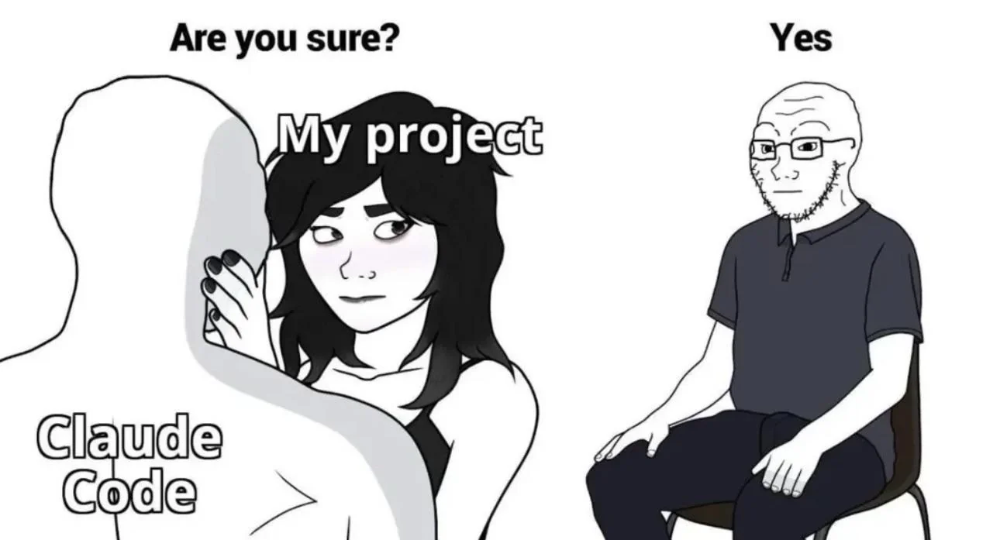

+++
title = "Advice Has a Half-Life λ"
date = "2026-11-10T18:16:58+02:00"
draft = true
lambdaEgg = true
authorTwitter = "cleanunicorn" #do not include @
cover = ""
keywords = ["ai", "coding agents", "agentic engineering", "systems thinking", "workflow", "skills", "code review"]
description = "Tools for coding agents change every month. The development lifecycle does not: define, plan, build, verify, review, ship. What repeats becomes the system."
showFullContent = false
readingTime = true
+++

<!--
DRAFT NOTES (delete before publishing)

Progress
  - [x] Read the deck (github.com/cleanunicorn/workshop-2026: slides/01..07, structure/readme.md, README)
  - [x] Read docs/writing-articles.md and the previous article, to extend it and not repeat it
  - [x] Map the deck onto the nine-section structure (map below)
  - [x] First full draft, with manager.cast in the bundle
  - [x] Skill list at the end, from agents-library as of 2026-11-09, and Chief of Staff mentioned once
  - [ ] Daniel: answer the open questions below
  - [ ] Daniel: confirm publication of the aggregate counts, including private repositories
  - [x] Check the draft against the structure, section by section; give each section a distinct job
  - [x] Look at it on `make dev` at desktop (1440px) and phone (390px) width
  - [x] Tightening pass: remove duplicate trail narration, rule lists and recap; make starter exercise concrete
  - [ ] Pick the title (options below), rename the slug before publishing
  - [ ] Pre-publish checklist in docs/writing-articles.md, then PR
  - [ ] Deferred: narration (`make audio`), social posts

Source: the workshop deck "Agentic Engineering" (38 minutes, 31 slides + annex).
The talk's two titles: "How to build the system around the agent" and
"Applied systems thinking in software development".

Section map (structure from docs/writing-articles.md -> this draft -> deck source):
  1. Proof              "Why believe me" (in the opening) git-stats cache: PRs merged, issues, median time to merge
  2. Results            "Follow one change"              NOT from the deck: Earheart issue #342 / PR #355 (Daniel
                                                         asked to replace the manager recording and to pick one change)
  3. Contradiction      "Do not watch it. Do not trust it either."   tips: build trust (both slides)
  4. What I did         "The loop" (six stages)          loop chapter
                        "What repeats becomes the system" review-your-flow chapter (the good/better/best
                                                         here is: a sentence, a check, a skill, code)
  5. Re-hook            "My Monday"                      define notes + transcripts tip + Earheart tip
  6. Get started        "Start with one stage"           closing call to action + shell history slide
  7. Won't work unless  "It will not work unless"        build trust (three failures) + scary agent guardrails
  8. Recap              "The short version"
  9. P.S.               future loops                     annex, as a plan
  +  Appendix           "What I run today"               requested: skill list, agents-library, Chief of Staff

Cut from the deck, on purpose:
  - Personal agents (pi, Hermes, OpenClaw): the slide notes say "[Daniel: which of the three you run today]";
    unknown, and the most perishable slide in the talk.
  - dispatch: one line in the appendix only.
  - The always-on machine ("black"): one sentence under Build. The previous article covers it.
  - Herdr install, good/better/best, "it is not the model": all in the previous article; linked, not repeated.
  - The docker.cast demo: in the previous article; linked from Verify.
  - GitHub Actions detail (PR title check, changelog script): two sentences under Ship.
  - Monitoring errors and performance: one paragraph under Define + the P.S., written as partly a plan.
  - The advice scale (complexity / usefulness / expected change per slide): only the idea survives.
  - The "cuck coding" joke and the hotel-room image: left out; the image is a Google Images thumbnail with
    no known licence. The point ("do not watch the agent code") is in the Contradiction section.

Numbers and facts, with sources:
  - "Why believe me": from Daniel's git-stats project (~/Development/github.com/cleanunicorn/git-stats),
    its cache .data/cleanunicorn.json, syncedAt 2026-11-10T18:46Z. I read the cache only and printed
    aggregates; I did not run a sync. Window = the 90 days before syncedAt (2026-08-12 to 2026-11-10, UTC).
      * 1,002 PRs merged in the window, in 19 repositories (592 of them in private repositories).
      * median creation-to-merge time of those PRs: 2.99 hours ("half within three hours").
      * 902 issues opened in the window.
      * the same 90 days one year earlier: 1 PR merged.
      * "ten pull requests a day" = 1,002 / 90 = 11.1, rounded down.
      * chart, PRs merged per month by mergedAt (UTC): Mar 4, Apr 72, May 102, Jun 142, Jul 206, Aug 208,
        Sep 234, Oct 464. November (153 so far) is left out because the month is not over.
    The earlier opening number (about 2,000 of 2,200 commits with an agent co-author) is gone: git-stats
    does not count co-authors, so the article no longer says what share of the work agents wrote.
  - "Follow one change", all read from GitHub on 2026-11-10 (cleanunicorn/earheart):
      * issue #342 filed 2026-10-30; four acceptance criteria in its body.
      * plan = issue comment 6624077247 (2026-11-04): milestones M1..M7; "make test 1313 pass / 0 fail" baseline.
      * plan review = comment 6624124456: two medium findings (correctness-1 match by identity not text;
        testing-1 stale search response). The plan's M4 line records the deviation.
      * PR #355: six commits, "17 files, +980 / -67", make test 1343 pass, settings-smoke 148/148, and the
        "145/146 with the guard removed" check, all from the PR body. Checks on the PR: app on ubuntu, macos,
        windows, lint-title, node-floor, repo-hygiene, stt-server = 7 green (the plan says "CI 7/7").
      * code review = comment 6624311900: two medium findings; fixes acca871 and 52a2462; re-check stopped at
        the SHA mismatch = comment 6624385892; re-check 2 verified both = comment 6624416256.
      * "a different vendor": commits carry a Claude co-author trailer; the plan's Progress says
        "Review (independent, codex)".
      * merged 2026-11-05 07:42 UTC; release v0.46.0 published 07:49 UTC and lists PR #355.
      * No durations are claimed. The four build commits share one timestamp (rebased), so the comment
        times do not show how long anything took.
  - "about 2 minutes of talking instead of 10 to 30 minutes of thinking alone": Earheart slide notes, marked
    there as "my own estimate, not a measurement". The draft says so.
  - The failures in "It will not work unless": build-trust slide notes ("what I skipped, once each").
    The notes do not say how each one played out, so the draft does not either. Add the real stories.
  - Editorial pass replaced the shell-history starter with a three-step verification exercise.
  - Skill and agent descriptions in the appendix: cleanunicorn/agents-library at its 2026-11-09 commit.
    The deck names older skills (plan-feature, review-pr, triage-issues, simplify-sweep, describe-codebase,
    install-agents); the repository no longer has those, so the appendix uses today's ten.
  - Chief of Staff: its README (default workflow Plan -> you approve -> Build -> Review -> Ship; steps can
    name skills).

Recording: none. manager.cast was removed with the "Watch this first" section.

Images in the bundle:
  - scariest-things.png: imgflip meme supplied by Daniel for the deck, watermark strip cropped there.
  - half-life, loop, plan, verify, review, three-times, monday (.svg): drawn for this article in the site's
    colours. The half-life chart is illustrative, not data, and says so.
  - chief-of-staff-pipeline.png: docs/images/pipeline-dark.png from cleanunicorn/bb-plugin-chief-of-staff.
    It shows demo data (the plugin's README says so), and the caption repeats that.
  - Not used: agents-library's manager-workflow.png and skill-*.png. They are light-themed and look
    pasted in on the dark page.

Open questions for Daniel:
  1. Opening numbers: the PR and issue counts include private client repositories (592 of the 1,002 merged
     PRs). Only totals are shown, no names. OK to publish? And do you want the agent co-author share back?
     It needs the workshop's `npm run numbers`, re-run for a window you choose.
  2. Editorial pass removed the unconfirmed claim about Daniel catching none of the three findings.
  3. Daniel confirmed: agents perform Verify (heavily script-powered) and Review, without his own pass.
     Monitoring: what runs today and what is a plan? The draft says only "I already monitor
     errors" (your notes) and calls the automatic issue filing a plan.
  4. Chief of Staff now has a labelled demo screenshot and a full-size image link.
  5. Do you want the personal agents or dispatch back in the body?
  6. "Timeless": the body names Herdr, Earheart and GitHub Actions only as "today's practice". If you want
     the body fully tool-free, the Earheart example is the one named project left in it.

Title: now "Advice Has a Half-Life λ" (Daniel asked for shorter, with the lambda). λ is both the
  Half-Life logo and the decay constant in the half-life formula, which the chart and one line under it use.

Earlier title options:
  - Build the System Around the Agent            (working title; the talk's subtitle)
  - I Do Not Trust My Agents. I Trust the System Around Them.
  - Advice About Coding Agents Has a Half-Life. This Part Does Not.
  - Don't Watch the Agent Code
  - What You Repeat Three Times Becomes the System
-->

Think of one thing you did three times this week. Keep it in mind. I will come back to it.

**By the end, you will have a set of skills you can use to build your own workflow.** They are public in [agents-library](https://github.com/cleanunicorn/agents-library), and I explain them at the end. Use them as they are, change them, skip a stage, repeat one, or add your own. The workflow is yours. The building blocks come from principles that have always been part of programming; agents give us new ways to apply them.

## Why believe me

In the 90 days to 10 November I merged about 1,000 pull requests across 19 repositories, and opened about 900 issues. Half of those pull requests were merged within three hours of being opened. In the same 90 days a year earlier, I merged one.



I do not like these numbers much. They say how much moved, not whether it was right. The useful question is **how to merge ten pull requests a day and still know what ships.** I will show one change from request to release, then the lifecycle and habits behind it.

## Principles and practices

Most advice about coding agents is about a tool, and the tool changes every month. It is hard to say something that is useful today and still true in a year.

So I split everything I do into two kinds.



λ is the decay constant: the larger it is, the sooner a thing stops being true. And yes, it is also the logo of a specific old game, Dr. Gordon.

The development lifecycle gives us building blocks. What you repeat three times becomes part of the system.



The tools and habits below are how I apply those principles today. Green boxes mark the principles; amber labels mark my practices. If you are reading this long after I posted it, keep the principles and adapt the practices.

## Follow one change

Here is one change, start to finish. It is from [Earheart](https://github.com/cleanunicorn/earheart), my open-source dictation app: search the History of what you dictated, and delete a single entry. Everything below is public, so you can open each step.



The trail is open to inspect: [the request and its acceptance criteria](https://github.com/cleanunicorn/earheart/issues/342), [the plan](https://github.com/cleanunicorn/earheart/issues/342#issuecomment-6624077247), [the code and test results](https://github.com/cleanunicorn/earheart/pull/355), [the review](https://github.com/cleanunicorn/earheart/issues/342#issuecomment-6624311900), and [the release](https://github.com/cleanunicorn/earheart/releases/tag/v0.46.0).

Three moments in that trail are the reason I work this way.

**A bug was caught before any code existed.** The plan said: when an entry is deleted, also drop the saved copy of a dictation if its text is the same. A second agent, whose only job was to attack the plan, [pointed out](https://github.com/cleanunicorn/earheart/issues/342#issuecomment-6624124456) that the same words are not the same dictation. Deleting an old entry would have thrown away a newer one that happened to say the same thing. The plan changed to match by identity, and the bug was never written.

**A test was proven to fail.** The agent wrote a check for a slow, outdated search answer arriving late and replacing the newer one. Then it removed its own fix, ran the check, and watched it fail: 145 of 146. Then it put the fix back. That shows the check can detect the bug it was written for.

**A reviewer refused to review.** When the fixes came back for a second look, the commit named in the reviewer's brief did not match the commit in front of it. It [stopped and said so](https://github.com/cleanunicorn/earheart/issues/342#issuecomment-6624385892), and marked nothing as fixed. It ran again once the commit was right.

**The useful result is what the process caught:** a mistake in the plan, a regression the test could detect, and a review aimed at the wrong commit. Here is the structure that made those catches possible.

## Trust the agents to do the work

There are two common ways to work with a coding agent.

The first is to watch it. You read every line as it appears and approve every command. It feels safe. It does not scale past one agent, and it turns you into a slow reviewer of your own tool.

The second is to accept the summary as the result. It feels fast, until the agent tells you the tests pass and they were never run.

**I trust the agents to build, verify and review.** Verification relies heavily on scripts; other agents review the work. I do not repeat those stages myself. The system gives the agents a way to check each other’s work and produce evidence beyond a summary.

## The software development lifecycle

Define, plan, build, verify, review and ship are building blocks you can arrange into your own workflow.



None of this is new. Teams worked this way long before agents. Somewhere in the excitement, we forgot that. **We expected AI to change how we work**, and assumed the principles we had learned no longer applied.

We still need to decide what is worth building, understand the code, check that a change works, and get it to users. Agents change how we do those things and who does them. **The principles still apply, even when the practices look completely different.** Without verification, mistakes reach users. Without a clear outcome, even a fast agent can spend its time solving the wrong problem.

| Stage | The question it answers | What I keep |
|---|---|---|
| Define | What is worth doing next? | The decision |
| Plan | How, exactly, in this code? | Reading the plan |
| Build | Does the code exist? | The rules it builds under |
| Verify | Does it work? | Acceptance criteria |
| Review | Is it right, and does it fit? | Review standards |
| Ship | Is it running for users? | An approval, sometimes |

Two things make it a lifecycle and not a checklist. Each stage hands the next one something written: an outcome, a plan, a pull request, evidence, findings, a release. What users do with the release feeds the next Define. A failed check sends the work back to Build; a flawed approach sends it back to Plan.

A stage does not need its own ceremony. For a small fix, planning might take one sentence; a risky change might need several rounds of verification and review. Choose the steps deliberately and understand what each one gives you.

### Define: decide what to work on next

Deciding what to build stays with a person. Ask for one outcome, not a list of tasks.

Talk to your user, your client or your own imagination, then pick one outcome. The user tells you what hurts. The client tells you what they pay for. Your imagination tells you what nobody has asked for yet.

Write the outcome and its boundary. "Let me delete one history entry without losing the others" gives the agent room to choose an implementation and gives you something to accept or reject. An ambition such as "keep the app crash-free" still needs a bounded first change.

**Define is done when you can say what success looks like and what is outside the change.**



A weekly standup feeds this stage; it is "My Monday", further down. Production feeds it too. I already monitor errors, and an error that keeps coming back, or a page that is up but far too slow, is something to work on next.

### Plan: grounded in reality

The plan is grounded in the code, and it is the plan the agent builds from.

Give the agent the relevant code, docs, issues, call transcript and repository history. Ask it to inspect the implementation before proposing changes.



Grounded means the plan names files and functions, not feelings: what changes, in which order, and what proves each step.



I ask for all the questions up front and answer them once. The plan carries the answers. A plan is a document I can read in five minutes. I read every plan for work that touches money or data. For small ones I skim the list of files and let it through.

### Build: stay out of the way

One writer per branch. What it delivers is a pull request, never a commit on main.

The agent writes the code, on its own branch, in its own copy of the repository. I do not read the keystrokes. I read the plan going by: which step it is on, what it decided when the plan turned out to be wrong, whether it stopped to ask.

The agents need somewhere to run where I can see them and step in.



Today that is a terminal on one machine that stays on, which I reach from whatever device I have with me. The tool will change. The need to see and to intervene will not.

### Verify: evidence, not reports

Verify is about evidence the agent produces, not claims it makes.





The agents run verification, heavily powered by scripts. Scripts handle repeatable checks; agents inspect the results, exercise the app and investigate failures. I do not run a second manual verification pass.

The evidence they produce:

1. **Test results from scripts**, with commands, exit status and output.
2. **Screenshots the agent took and looked at.** An agent that can open the running app and look at it catches what a test does not.
3. **A real deploy to staging.**
4. **Acceptance checks**, exercised by the agents and automated in scripts wherever possible.

### Review: three questions, then one concern each

Review one identified commit, challenge the implementation, and support findings with evidence.

I ask three questions of every pull request. Does it fit the architecture? Is it correct? Can it be simpler or faster?



A useful finding names the file and line, explains what can go wrong, and gives a way to check it. The reviewer needs the requirements and the diff, but should reach its own conclusion before reading the writer's verdict.



I use a reviewer from a different vendor to vary the perspective; that alone does not guarantee it will catch a mistake. I also run reviewers that each have a single concern: dead code, missing tests, security hygiene, documentation gaps. One question each, and each opens its own small pull request. The list is in the appendix.

The agents handle the findings and check the fixes. I trust them to perform the review; I do not add a personal code-review pass. An approval or merge decision is separate from doing the verification and review myself.

### Ship: usually automatic

A merged change reaches its users without anyone remembering to do anything.

Once the checks live in CI, an agent's pull request and mine are held to the same bar.



Mine run in CI: the tests, a check on the pull request title because the release script reads it to pick the version, and a release that writes its own changelog entry. Scripts carry a merged pull request to staging and production. **The only place I appear is an approval, and on some projects not even that.**

## What you repeat three times becomes the system

The first time, I do it. The second time, I notice it. The third time, I build it into the system.

It is the same rule I use when I refactor code. Two copies are a coincidence. Three are a pattern, and a pattern gets a name and a single place to live. The rule works on habits the way it works on code.



Look for the next piece of your system in the logs you already keep:



- **Shell history → a tool.** `gup` is `git switch main && git pull`. A sequence I kept typing became a name both the agent and I can call.
- **Agent sessions → a skill.** Repeated corrections reveal a workflow worth writing down once. Keep the decisions and checks; drop instructions the model no longer needs.
- **Repository history → an enforced check.** The same fix or review comment keeps returning? Turn it into a lint or test when you can describe the failure precisely.
- **Agent memory → a reviewed rule.** Read its notes about you. Keep what is still true, correct what it misunderstood, and remove what no longer applies.

**Put each repetition where it can be handled reliably.** A preference can stay in prose. A workflow that needs judgement belongs in a skill. A mechanical check belongs in a test or CI job that blocks a merge when it fails.

The skill itself gets the same treatment. If an agent runs the same five commands every time, make them a script. Let code handle the fixed sequence and leave the decisions to the model.

Every few weeks, prune the result. Rules become obsolete, contradict each other, or describe mistakes fixed upstream. Ask whether each one still earns its place.

The goal is to make the easy thing the right thing. Agents take shortcuts, so shape the environment until the shortcut is correct. It works the same way for a new hire.

## My Monday



The Earheart example shows one finished change. Here is how I turn a messier conversation into work worth starting.

On Monday there is a standup. It is weekly, not daily. I save the transcript, and I keep a notebook of what we decided to work on.

I give an agent the transcript, its summary, and my notes. Each preserves something different: what was said, what seemed important, and what I decided.



**The agent flags disagreements; I resolve them before it files issues.** The transcript might say one thing and my notes another. Five similar complaints in one call are one issue with a theme, not five issues.

The agent files the issues, each one written next to the code: files, what done looks like, how to check it. I read every line of the ones that touch money or data. The small ones I let through.

I speak most of this. A hotkey, I talk, and the cleaned text lands in the prompt. My changes of mind stay in the text, so the agent sees how I got there.

By lunch there is a set of issues with decisions attached. Those are the inputs to Plan.

## Start with one stage

Take the thing you thought of at the top and choose one change it could improve. Start by handing over Verify: it has a clear input, a running change, and a result you can inspect.

### 1. Name what must work

Write one acceptance criterion before asking the agent to test. For the history example:

> Deleting one entry leaves another entry with identical text intact.

**Check:** could someone who did not write the code tell whether it passed?

### 2. Ask for evidence you can inspect

Give the agent the change and the criterion:

> Find and run the relevant tests. Show the commands, exit status and results. Exercise the acceptance criterion in the running app. For a UI change, take and inspect screenshots. Report anything you could not check.

**Check:** open the output and the screenshots. If a test is meant to catch a bug, ask the agent to demonstrate that it fails without the fix in a disposable working copy.

### 3. Make the useful check repeatable

Save the command as a script or project task. Run it from a clean checkout, then add it to CI and require it before merging. Keep manual checks explicit where automation is incomplete.

**Check:** deliberately break the relevant behaviour on a throwaway branch. The check should fail there and pass with the fix restored.

You now have one stage with evidence and one repeatable check. Next, add a separate review, then capture the workflow as a skill when you have used it enough to know what belongs in it.

## It will not work unless

The failures behind this setup were ordinary ones: two agents editing the same files, a model grading its own work, and "tests pass" accepted without a run. The lifecycle gives each of those a place to be caught.

The remaining constraint is the reach of the tools you hand over. **Each new capability needs a boundary and a way to check its consequences.**

Build an agent that scares you a little, but add capabilities one at a time. A browser, database access or SSH changes what it can accomplish—and what a mistake can damage.



Each tool comes with its own guardrail. The browser gets a throwaway profile. The database is a copy, or a read-only user first. The SSH keys go to a staging host before production. Docker runs in a container per project, and the Docker socket stays out of that container unless I mount it on purpose, because a mounted socket is the host.

Grant autonomy only as far as you can verify the consequences. When a new tool makes you uneasy, name the failure you are worried about and add a check or limit for it.

## The short version

The lifecycle gives each change a path from a decision to a release, with evidence at the handoffs. The rule of three improves that path: repeated work becomes a tool, a skill or an enforced check.

About a thousand pull requests in 90 days went through this. The count shows how much moved. The Earheart trail shows the more useful part: mistakes caught before they reached users.

**Pick one repeated task, hand over its verification, and keep the check that proves it worked.**

*P.S. The lifecycle still has a gap at the end: after Ship, I am the one who notices that something broke. What I want to build next is that last arc. An error becomes an issue, the issue becomes a fix that is verified after it deploys, and one channel tells me what the loops did and what they need from me. It is a plan, not something that runs today.*

## Appendix: what I run today



Use this as a reference if you want to try the workflow. The article's principles do not depend on these tools.

### The skills

My skills are in [agents-library](https://github.com/cleanunicorn/agents-library), and they are public. A skill is a workflow written down in words, which an agent loads when you type its name.

**There is one skill for each stage of the lifecycle:**

- **Define:** `/define`. Turns a loose request into a problem statement, a scope (in and out) and done-criteria, and writes them to the issue.
- **Plan:** `/plan`. Breaks the issue into small tasks that can each be verified, with acceptance criteria and an order. Writes no code.
- **Build:** `/build`. Works one task at a time, test first: a failing test, the minimum code to pass, the full suite, one commit.
- **Verify:** `/verify`. Exercises every acceptance criterion end to end, records pass or fail, and lists the gaps.
- **Review:** `/review`. Reads the diff for correctness, readability, architecture, security, performance, dead code and stale docs, and verifies each finding before reporting it.
- **Ship:** `/ship`. Pushes the branch, opens a pull request that links the issue, and marks it ready when everything is done.

And four that sit around it:

- `/manager`. Turns the session into a console that runs one coordinator per work item, through plan, build, review and test, to one pull request. It never does the work itself. [How it works](/posts/one-prompt-a-whole-team/) is a separate article.
- `/file-issues`. A long-lived session that turns each thing I describe into a well-formed issue, after searching for duplicates. It never edits code.
- `/batch-merge-prs`. Merges a list of pull requests onto one new local branch, then runs the tests and reviews the result. It never pushes.
- `/review-ux-psychology`. Reviews a flow's defaults, framing and progress to move one named metric, such as signup or checkout.

### The reviewers with one concern

These are the single-concern reviewers from the Review stage. They are in the same repository. Each picks one problem, fixes every instance of it, verifies the result and opens a pull request.

| Agent | Its one concern |
|---|---|
| `architect` | Code that bypasses a layer boundary or duplicates a shared helper |
| `deadwood` | Dead code: unused imports, unreachable branches, orphaned files |
| `docbot` | Missing or stale documentation |
| `refactor` | Small refactors that do not change behaviour |
| `sentinel` | Security hygiene: missing auth guards, leaked error details, hardcoded secrets |
| `testforge` | Gaps in the test suite, weak assertions, flaky tests |
| `uidesigner` | Visual design that drifts from the project's own tokens and components |
| `uxpolish` | Frontend friction: missing loading, empty and error states, labels, keyboard handling |

Take them, change them, or write your own. Other people's skills combine well, but everyone should have their own set of knives.

### The rest

- [Chief of Staff](https://github.com/cleanunicorn/bb-plugin-chief-of-staff) is the same lifecycle drawn as a workflow. It is a plugin for [BB](https://getbb.app) that takes GitHub issues, or tasks I describe, through steps I draw: plan, my approval, build, review, ship. Each step can name one of the skills above, and a board shows where every task is and whether an agent or I have to act next.
- [Earheart](https://github.com/cleanunicorn/earheart) is the dictation app from "Follow one change". It is also how I speak my prompts.

Chief of Staff in BB, with demo data: six tasks at different stages, one waiting for plan approval. <a href="chief-of-staff-pipeline.png" target="_blank" rel="noopener">Open the full-size screenshot</a> to read the cards.
